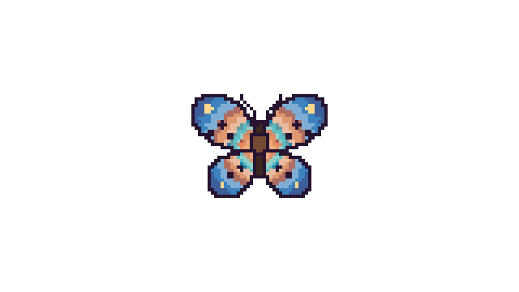
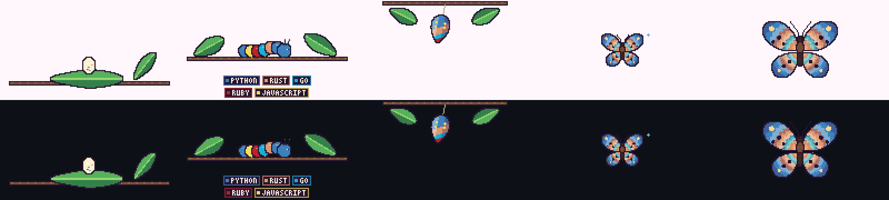
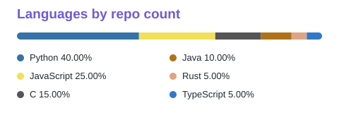

# Git butterfly 🦋

A pixel-art butterfly that **grows with your GitHub contributions**.
She starts as an egg, becomes a caterpillar, spins into a cocoon, and finally hatches into a butterfly that flies around your profile README. The **colors of her wings come from the programming languages you use**.





She also writes a **Languages by repo count** card with every language you use and its real GitHub color:



## How she grows

| Stage | Contributions (default) | What you see |
| --- | --- | --- |
| Egg | 0 – 24 | An egg on a leaf. It wobbles a little. |
| Caterpillar | 25 – 299 | Crawls on a branch. Gets longer and fatter. Every body segment wears one of your language colors, and name tags for your top languages sit under the branch. |
| Cocoon | 300 – 799 | Hangs from a branch and sways. Striped with your language colors. |
| Butterfly | 800+ | Flies a figure-8 path and flaps her wings. **Gets bigger** until about 4000 contributions. |

You can change the numbers with `--thresholds 25,300,800`.

**Wing colors.** Every language you commit in gets its own color band on the wings.
The language you use most is the biggest, outer part of the wing. Greys (like C) are brightened so every wing is pretty.
Near her body the wings glow warm gold, like the pink and orange pixel butterfly this project is based on.

**Streak sparkles.** If you contributed 3 or more days in a row, she leaves sparkles behind her when she flies. A longer streak means more sparkles.

## Put her on your profile (3 steps)

1. **Fork or push this repo** to your GitHub account as `git-butterfly`.
2. In your **profile repository** (the repo named exactly like your username), create `.github/workflows/butterfly.yml` and paste [`examples/profile-workflow.yml`](examples/profile-workflow.yml). Change `YOUR_USERNAME` to your username.
3. Add this line to your profile `README.md`:

   ```html
   <a href="https://github.com/YOUR_USERNAME/git-butterfly"></a>
   
   ```

   Wrapping the GIF in the `<a href=...>` link makes it clickable: anyone who clicks her lands on this repo.

Then open the **Actions** tab, choose **Update butterfly**, and press **Run workflow**. After that she updates herself every night.

> **Private contributions:** the default token only sees public activity. To count private work too, create a personal access token with the `read:user` scope, save it as a repository secret named `BUTTERFLY_TOKEN`, and uncomment the `token:` line in the workflow.

## Try it on your computer

You need Node.js 18 or newer.

```bash
npm install
npm run start -- --demo --out demo.gif              # no internet or token needed
GITHUB_TOKEN=ghp_xxx npm run start -- --user YOUR_USERNAME --out butterfly.gif
```

Preview any stage without waiting for contributions:

```bash
npm run start -- --demo --total 10   --out egg.gif
npm run start -- --demo --total 150  --out caterpillar.gif
npm run start -- --demo --total 550  --out cocoon.gif
npm run start -- --demo --total 5000 --streak 12 --out grown.gif
npm run start -- --demo --langs "Python:50,Rust:30,Go:20" --out colors.gif
```

### Options

| Option | Meaning |
| --- | --- |
| `--user NAME` | GitHub username |
| `--token TOKEN` | GitHub token (or set `GITHUB_TOKEN`) |
| `--out PATH` | Output GIF, default `butterfly.gif` |
| `--scale N` | Pixel size, default 4 (a 640×360 GIF) |
| `--thresholds A,B,C` | Contributions for caterpillar, cocoon, butterfly |
| `--demo` | Made-up stats, works offline |
| `--total N`, `--streak N`, `--langs LIST` | Override the stats (good for testing) |
| `--sheet PATH` | Also write a PNG with every life stage |
| `--legend PATH` | Also write the "Languages by repo count" card as an SVG (the Action does this for you) |

## How it works

- `src/fetch.ts` asks the GitHub GraphQL API for your contributions in every year, your current streak, and the main language of each repository you committed to.
- `src/model.ts` decides the life stage and size, and turns languages into wing color bands.
- `src/legend.ts` draws the languages card (a colored bar plus a legend, with every language and its percentage).
- `src/render.ts` draws the pixel art with plain code (no image files and no native libraries).
- `src/gif.ts` writes a transparent looping GIF, so she looks good in light and dark mode.
- `action.yml` is the GitHub Action that runs all this every night.

The butterfly lives inside the GIF frame, so she flies around that area of your README. She cannot leave the picture.

## Development

```bash
npm test          # unit tests
npm run typecheck
npm run build
```

## Credits

The idea comes from [git-koi](https://github.com/yalongwastaken/git-koi) by Anthony Yalong (a pixel-art koi for your profile). This is a separate project written in TypeScript with its own code and artwork, and no code was copied from git-koi.

MIT license.
